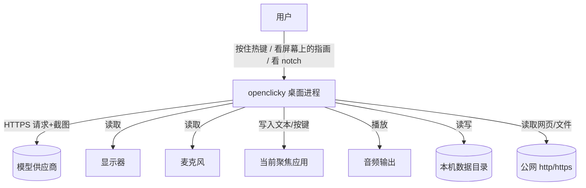
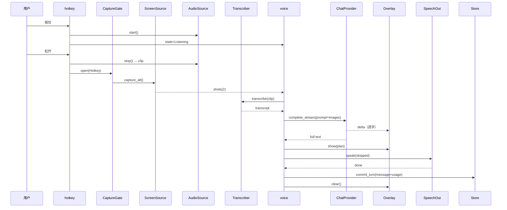

# 01 技术实现 PRD — OpenClicky 2.0

| 项 | 值 |
|---|---|
| 文档编号 | OC2-TECH-PRD |
| 版本 | 2.0（2026-11-23，重写：补全每项需求规格、视图、威胁模型、故障分类、SLI/SLO、自查记录） |
| 状态 | **已批准**（可作为实现依据；状态定义见 §01.3） |
| 技术负责人 | 人类维护者 |
| 评审者 | 架构复核 Agent（提交意见）、人类维护者（裁决） |
| 适用发布 | v2.0.0，及 v2.x |
| 关联 | `00-baseline.md`、`adr/ADR-0001…0013`、`02-sdd.md`、`04-test-design.md`、`05-deployment.md` |

**这份文档要回答的四件事**（也是评审只看这四条）：

1. 系统必须保证什么（含保证边界与不能保证的事）。
2. 准备用什么机制兑现，责任落在哪个组件。
3. 什么情况下会坏、坏了怎么办。
4. 凭什么相信它兑现了，证据在哪，还没证明的有哪些。

产品行为以源 PRD 为准；本文只把它翻译成**有机制、有边界、有责任人、有验证路径**的工程约定。字段级设计在 SDD，决策理由在 ADR，测试数据与证据在 TDS。

---

# A. 技术基线

## 01 文档基线、负责人与适用范围

### 01.1 基线与范围

| 字段 | 内容 |
|---|---|
| 代码基线 | 本仓库 `main`；首个交付 tag `v2.0.0` |
| 目标平台 | macOS 13+（arm64 + x86_64）、Windows 10 1809+/11（x64）、Linux x86_64（X11 必需；Wayland 受限） |
| 运行形态 | 单机桌面应用，本地优先，无自有服务端 |
| 覆盖代码 | `crates/core`、`crates/platform`、`apps/desktop`、`apps/cli`、CI 与打包脚本 |
| 不覆盖 | 源 PRD 之外的形态（Web、移动、浏览器扩展、团队后台） |

### 01.2 四种状态，互不替代

| 状态 | 含义 | 记录位置 | 谁可以改 |
|---|---|---|---|
| 拟议 | 方案已写，未评审 | ADR `Draft/Proposed` | 任何人 |
| 已批准 | 评审通过，可据以实现 | ADR `Accepted` + 本文条目状态列 | 技术负责人 |
| 已实现 | 代码合入 `main` | PR + commit | 实施者 |
| 已验证 | 有绑定该 commit 的证据 | `06-acceptance.md` | 验收负责人 |

禁止把"设计通过评审"写成"系统已有该保证"。本文所有条目在实现前一律标 `状态：已批准 / 未实现`。

### 01.3 变更与裁决

| 变化 | 需要什么 |
|---|---|
| 模块内部实现细节 | 仅更新 SDD |
| 契约（trait 签名、DDL、注解语法、错误码） | 更新本文 + SDD + 新增/修订 ADR + 通知全部下游 |
| 削减产品承诺（把"必须"改成"尽量"） | 新增 ADR + 产品侧（用户）确认；禁止工程单方面降级 |
| 提高验收门槛 | 更新 TDS + 记录在 PR |
| 修改 CI/保护规则 | 只有人类维护者；需要在 PR 描述写原因与补验计划 |

冲突裁决顺序：产品行为 → 源 PRD；技术承诺 → 本文；决策理由 → 最新 Accepted ADR；细节 → SDD；测试预期 → TDS。两份 ADR 冲突时按**适用范围与生效条件**判断，不以编号或时间排序。

---

## 02 技术背景、现状、目标与非目标

### 02.1 现状

绿地项目；单维护者 + 多 Agent 并行；无历史数据、无服务端、无运营能力。要交付的是**能日常使用**的桌面产品，不是演示。

### 02.2 硬约束（不可由本方案自行改变）

| 编号 | 约束 | 违反后果 |
|---|---|---|
| C-1 | 三平台同一代码基，不为某平台开分叉主干 | 单维护者无法维护 |
| C-2 | 不依赖本仓库外的服务端 | 无法分发、无运维能力 |
| C-3 | 密钥不进仓库/日志/崩溃报告/SQLite | 安全事故 |
| C-4 | 只在用户按键瞬间采集屏幕；无后台截屏 | 信任崩塌（产品根基） |
| C-5 | 测试离线、确定、可重复 | 三平台 CI + 无密钥环境无法验证 |
| C-6 | 模型供应商可替换（OpenAI / Anthropic / OpenAI 兼容） | 单点失败 |
| C-7 | 单个安装包 ≤ 120MB，待机 RSS ≤ 220MB | 目标用户（普通电脑用户）可接受度 |

### 02.3 方案选择（可改变，改变需 ADR）

Tauri 2 壳 + Rust 核心 + 无框架 TypeScript；SQLite；TOML 配置；系统钥匙串。

### 02.4 待验证假设（每条都有负责人与关闭条件）

| 编号 | 假设 | 证据现状 | 关闭方式 | 若失败的调整 |
|---|---|---|---|---|
| H-1 | `xcap` 三平台可取多显示器原始分辨率 + 正确 scale | 未验证（文档级） | 三平台打包冒烟 + 校准模式 | 平台直调 CGDisplay/DXGI/XShm（重审 ADR-0003） |
| H-2 | `enigo` 可注入 Unicode 文本与组合键 | 未验证 | 冒烟：向 5 类应用注入中文 | macOS CGEvent 直调；Windows SendInput |
| H-3 | `cpal` 蓝牙耳机不吞开头 200ms | 未验证 | 冒烟：AirPods + USB 麦 | 录音前静音预卷 300ms |
| H-4 | Tauri 透明穿透覆盖窗三平台可用 | 部分（文档） | 打包冒烟：覆盖层不挡点击 | Windows 分层窗口；Linux X11 shape |
| H-5 | keyring 在主流 Linux 桌面可用 | 未验证 | 冒烟：GNOME/KDE | 加密文件降级（已设计） |
| H-6 | 供应商兼容端点支持 vision + SSE | 未验证 | `doctor --online` | 提示切换 provider |

### 02.5 非目标（本次明确不做，且不因此降低质量）

| 非目标 | 原因 | 若将来要做的前置 |
|---|---|---|
| 支付/套餐/发票 | 自托管无结算主体；改为预算护栏 | 结算主体 + 服务端 |
| 团队版后台 | 无服务端 | 账号体系 |
| Chrome 扩展 | 商店发布 + 独立审核 | 扩展工程与审核流程 |
| 3D / 照片卡片渲染 | 成本高、与"教"核心弱相关 | 渲染预算与真机验证 |
| 应用连接器市场（Gmail/Notion…） | 需托管 OAuth | 授权托管方案 |
| 手机端 | 平台范围外 | 移动团队 |
| 本地推理 | 只支持"本地 OpenAI 兼容端点" | 模型分发与量化工程 |
| 无障碍全覆盖 | 只保证键盘可达 + 字号缩放 | 专项审计 |

---

## 03 产品需求 → 技术需求追踪

### 03.1 追踪原则

- 每条技术需求必须有唯一编号 `TR-xx`，并能反查：来源（源 PRD 条目/质量要求/平台限制）、责任组件、验证用例。
- 反向也要成立：不存在没有需求依据的工程建设。
- 详细规格见**附录 A（TR 规格表，10 字段）**；这里只给索引与承接关系。

### 03.2 索引（摘要）

| TR | 派生自 | 一句话要求 | 责任组件 | 验证 |
|---|---|---|---|---|
| TR-01 | B1/B13 | 热键按下即开始、松开即提交、再按即打断 | `hotkey`,`voice` | TC-HK-*, TC-E2E-ASK-* |
| TR-02 | B2,B19,C7 | 采集只能由按键开启，且一次会话只用本次截图 | `privacy`,`capture` | TC-SEC-001 |
| TR-03 | B4 | 按住期间的鼠标轨迹必须并入参考图并带坐标 | `gesture` | TC-GEST-001 |
| TR-04 | B5,P2 | 语言自动识别，中途换语言不失败 | `providers::stt` | TC-STT-002 |
| TR-05 | B6 | 快/深模型自动路由，用户无选择器 | `router` | TC-RTE-001 |
| TR-06 | B6 | 深答可跑数分钟且不被截断 | `providers`,`voice` | TC-PRV-004 |
| TR-07 | B7,B14,B15 | 有声回答；静音兜底剪贴板；链接直接打开 | `speech`,`voice` | TC-SPK-001/002 |
| TR-08 | B9,B10,B11,B12 | 记住回答方式；看屏再给下一步；回看刚离开页面；读全文 | `prompt`,`memory`,`tools::html` | TC-PRM-003, TC-MEM-001 |
| TR-09 | B16,B17 | 被策略拦下要直说；能回答自身状态 | `voice`,`config` | TC-ERR-005 |
| TR-10 | B18 | 麦克风异常自动切换并说明；断网自动重连 | `audio`,`providers` | TC-AUD-002 |
| TR-11 | C1–C9 | 打字提问、附件、草稿保留、滚动位置 | `ui`,`store` | TC-UI-003 |
| TR-12 | D1–D4 | 指与画的协议、坐标换算、锚点跟随 | `annotations` | TC-ANNO-001…013 |
| TR-13 | D5–D8 | 卡片/3D/回放/次数限制 | 裁剪（见非目标） | — |
| TR-14 | E1–E9 | 带做：命中推进、miss 释放、≤15 步、continue 门 | `walkthrough` | TC-WALK-001…005 |
| TR-15 | F1–F10 | 听写：增量出字、整理、词典、终端安全、粘回原剪贴板 | `dictation` | TC-DICT-001…010 |
| TR-16 | G1–G3 | 替你写：看屏起草、就地改、失败兜底 | `dictation`,`prompt` | TC-DICT-011 |
| TR-17 | H1–H3,H13 | 任务启动判定、10 秒不计费、先做再问 | `agent`,`usage` | TC-AGT-001/002 |
| TR-18 | H4–H10 | 任务卡、进度折叠、追加消息、Stop/Retry/Keep going、长任务 | `agent`,`ui` | TC-AGT-003/004 |
| TR-19 | H11,H12,H18 | 看门狗、历史保留、模型失败自愈 | `agent` | TC-AGT-005, TC-ERR-003 |
| TR-20 | H16,H17 | 表格输出规范；Your turn + Open page | `agent`,`ui` | TC-AGT-008 |
| TR-21 | I1–I9 | 连接应用与多账号 | 裁剪为 MCP/HTTP 工具 | TC-TOOL-* |
| TR-22 | J1–J7 | Chrome 扩展办事 | 非目标 | — |
| TR-23 | K1–K8 | 操作电脑（drive） | 裁剪为"工具 + 批准"，不做全局接管 | TC-POL-* |
| TR-24 | L1–L9 | 定时任务语义（补跑一次、三连失败暂停、离线不计） | `routines` | TC-RTN-001…004 |
| TR-25 | M1–M9 | 建议与下一步的打扰预算 | `suggest` | TC-SUG-001…004 |
| TR-26 | N1–N5 | 记忆双文件、不截断偏好、可遗忘 | `memory` | TC-MEM-001…004 |
| TR-27 | Q2–Q6 | 用量语义：共用额度、百分比、10 秒、审批不计 | `usage` | TC-USE-001…006 |
| TR-28 | S1–S5 | 隐私、删除、密钥 | `security`,`store` | TC-SEC-001…006 |
| TR-29 | T1–T4 | 更新、单实例、自启 | `updater`,`singleton` | TC-APP-001/002 |
| TR-30 | 质量目标 | 首字/首音延迟、CPU、内存 | 全链路 | TC-PERF-* (本地) |

---

## 04 可衡量的质量目标与保证

### 04.1 SLI 定义（测量点写死，避免"看起来快"）

| SLI | 起点 | 终点 | 采样 | 窗口 | 目标 | 负责人 |
|---|---|---|---|---|---|---|
| `voice.first_delta_ms` | 热键 release（UI 事件时间戳） | 首个 SSE delta 应用完成 | 每次提问 | 7 天 p50/p95 | p50 ≤ 1500ms / p95 ≤ 3500ms | `voice` |
| `voice.first_audio_ms` | release | 扬声器首帧（播放器回调） | 每次提问 | 7 天 | p50 ≤ 2500ms / p95 ≤ 5000ms | `speech` |
| `capture.duration_ms` | gate.open | 所有显示器 PNG 完成 | 每次采集 | 7 天 | p95 ≤ 250ms（4K×2） | `capture` |
| `stt.latency_ms` | audio.stop | 转写返回 | 每次 | 7 天 | p50 ≤ 900ms（≤12s 音频） | `providers` |
| `dictation.first_inject_ms` | 录音开始 | 首次注入完成 | 每次 | 7 天 | p50 ≤ 900ms | `dictation` |
| `task.success_rate` | — | 完成/(完成+失败+取消) | 每任务 | 30 天 | ≥ 85%（基准 10 任务） | `agent` |
| `task.stall_rate` | — | 触发看门狗的比例 | 每任务 | 30 天 | ≤ 2% | `agent` |
| `app.crash_per_100_sessions` | — | 崩溃退出次数 | 每会话 | 30 天 | < 0.5 | 壳层 |
| `idle_cpu_pct` | — | 待机 60s 均值 | 每次冒烟 | 单次 | ≤ 3% 单核 | 壳层 |
| `rss_mb` | — | 待机常驻 | 每次冒烟 | 单次 | ≤ 220MB | 壳层 |

**统计口径**：失败请求计入分母（不剔除）；超时按失败计；p95 用最近 1000 次；数据来自本地 `metrics_daily`，不上报。

**设计目标 vs 实测**：上表为**设计目标**。实测值在 `06-acceptance.md` 的 G3 记录；未实测写"未实测"，不得写"达标"。

### 04.2 必须保持的正确性约束（不能用错误预算抵扣）

| 编号 | 约束 | 违反即阻断发布 |
|---|---|---|
| INV-1 | 未按键时屏幕采集次数 = 0 | ✅ |
| INV-2 | 密钥明文不出现在日志/SQLite/导出物 | ✅ |
| INV-3 | 不代填密码/验证码/卡号 | ✅ |
| INV-4 | 删除账号后 OpenClicky 的数据目录与钥匙串中不再有可读用户内容；**系统级备份（Time Machine 等）与磁盘残留块不在保证范围**，必须在删除报告中逐项明示 | ✅ |
| INV-5 | 工具**默认**不得写出工作区（含符号链接与 `..`）；只有在用户逐次批准后，才可写指定工作区外路径，且必须审计（与 TR-23 一致；默认拒绝优先） | ✅ |
| INV-6 | 同一任务用量不重复计入 | ✅ |
| INV-7 | 任一工具调用前重新检查授权与预算 | ✅ |
| INV-8 | 非幂等工具在"结果未知"时不自动重放 | ✅ |

---

# B. 系统设计

## 05 系统边界与总体架构

### 05.1 系统上下文（谁和谁说话）



边界声明：**我们只保证本进程内的行为**；模型输出质量、供应商可用性、系统权限弹窗、用户环境网络不在保证范围（见 §13 失败分类）。

### 05.2 容器/进程视图

单进程。逻辑分三层，**不是**三个服务：

| 层 | 代码 | 可依赖 | 禁止依赖 |
|---|---|---|---|
| 领域层 | `crates/core` | serde/rusqlite/chrono 等纯库 + 自定义 ports | Tauri、GUI、HTTP 客户端、`std::process` |
| 平台层 | `crates/platform` | OS API + 第三方系统库 | 业务规则 |
| 壳层 | `apps/desktop`、`apps/cli` | core + platform + Tauri | 业务判定（只做装配与展示） |

### 05.3 部署视图

| 部分 | 位置 | 说明 |
|---|---|---|
| 应用二进制 | 用户机器 `Applications/`（mac）、`Program Files`（win）、`/usr/bin` 或 AppImage（linux） | 单文件 + 资源 |
| 数据 | `app_data_dir`（见 §19.2） | SQLite、记忆、配置、日志、工作区 |
| 模型 | 远端或本地兼容端点 | 唯一出站依赖 |
| 更新 | 静态托管（GitHub Releases） | 只有检查更新时访问 |

### 05.4 数据流与信任边界（含出境）

| 数据 | 起点 | 是否出境 | 本机落地 | 保留 |
|---|---|---|---|---|
| 截图 | 按键瞬间 | ✅ 单次请求 | 仅内存；可选最近 1 帧用于重绘 | ≤ 24h |
| 麦克风音频 | 按键期间 | ✅ STT | 内存；失败可留 1 份重试 | ≤ 24h |
| 转写文本 | STT | ✅ 作为用户消息 | SQLite | 至删除 |
| 对话/任务 | 用户 + 模型 | ✅ | SQLite | 至删除 |
| 记忆 | 派生 | ✅ 注入 prompt | 两个 md 文件 | 至删除 |
| 密钥 | 用户输入 | ❌ 仅作为请求头发给该 provider | 钥匙串（或降级加密文件） | 至删除 |
| 日志 | 派生 | ❌ | JSONL | 7 天 |
| 审计 | 派生 | ❌ | SQLite | 至删除 |
| 工作区文件 | 用户/工具 | 上传时需批准 | 磁盘 | 至删除 |

### 05.5 架构箭头的含义（禁止一条线糊过去）

| 图形 | 含义 |
|---|---|
| 实线箭头 `-->` | 同步调用（有返回值） |
| 虚线 `-.->` | 异步/后台线程 |
| 双箭头 `<-->` | 双向协议（HTTPS 请求/响应） |
| 标注 "读写" | 持久化，涉及权威数据 |
| 标注 "批准" | 存在权限执行点 |

## 06 子系统划分、职责与所有权

| 模块 | 负责 | 明确不负责 | 拥有的权威数据 | 失败影响 |
|---|---|---|---|---|
| `voice` | 一次问答的编排、状态机、取消 | 采集实现、渲染 | 会话状态 | 问答不可用 |
| `annotations` | 注解语法、校验、坐标换算、渲染计划 | 画像素 | 无 | 指错位置 |
| `router` | 快/深选择 | 模型能力探测 | 无 | 慢或贵 |
| `providers` | 协议、流式、重试、错误分类 | 决定问不问 | 无 | 无法回答 |
| `agent` | 任务状态机、循环、检查点、预算 | 工具副作用 | 任务/步骤 | 任务失败 |
| `tools` | 工具注册、参数校验、策略判定、沙箱 | 模型推理 | 工作区文件 | 越权风险 |
| `walkthrough` | 步骤推进与命中 | 点击检测 | 步骤台账 | 带做错位 |
| `dictation` | 增量合并、整理、词典、注入策略 | 注入实现 | 词典 | 听写不可用/破坏输入 |
| `routines` | 频率解析、下次触发、失败策略 | 定时器 | 定时任务 | 不按时跑 |
| `suggest` | 打扰预算 | 生成建议内容 | 预算状态 | 打扰过多 |
| `memory` | 双文件读写、注入、遗忘 | 记忆推理 | 记忆文件 | 记错/忘不掉 |
| `usage` | 计量、预算、豁免 | 真实计费 | 用量事件 | 花费失控 |
| `store` | schema、迁移、事务 | 业务规则 | 全部持久化 | 数据损坏 |
| `security` | 脱敏、摘要、密钥类型 | 业务判定 | 无 | 泄漏 |
| `privacy` | 采集门禁 | 采集实现 | 门禁计数 | 隐私事故 |
| `platform::*` | OS 能力 | 任何业务规则 | 无 | 能力缺失（降级） |
| `apps/*` | 窗口、命令桥、调度 | 业务判定 | 无 | UI 不可用 |

**所有权规则（谁都不能破）**

1. 任务"是否完成"只由 `agent::transition` 决定，展示层只读。
2. 用量只能由 `usage::meter` 写。
3. 任务状态只能由持当前 `epoch` 的执行者写（SDD A-12）。
4. 采集只能由 `CaptureGate` 开启。

## 07 关键运行流程、状态机、并发规则

### 07.1 流程 ASK（问屏幕）



**各步失败去向**：`capture` 失败 → 无图回答 + 提示缺权限；`stt` 失败 → 重试 1 次（总共 2 次）→ `E_SHORT/E_NET`；`chat` 失败 → 分类错误卡；`speech` 失败 → OS TTS → 剪贴板；`store` 失败 → 回答仍展示，标"未保存"。

### 07.2 流程 TASK（交办）

1. 用户说出任务 → `classify`（是讲还是办）→ 需要 `Task`。
2. `create(goal)` → `Queued`，落库。
3. 调度线程取队首（并发 < 3）→ `Running`，epoch=1。
4. 每步：`context → complete(tools) → policy → execute → record_step → checkpoint`。
5. 需要批准 → `WaitingApproval`，卡片出三种按钮。
6. `finish` → 证据核验 → `Completed` / `CompletedUnverified`。
7. 看门狗 20 分钟无事件 → `Paused(inactivity)`。

### 07.3 流程 DICTATE（听写）

```
hold → audio.start → state=Dictating
tick 700ms → transcribe(window) → merge_partial → inject(suffix)
release → final transcribe → tail-correct(20s) → cleanup → dict-learning → meter
```

失败：注入抛错 → 剪贴板 + 明说；`guards` 拒绝 → 不注入并说明；音频过短 → 丢弃。

### 07.4 语音状态机（含守卫与副作用）

| 当前 | 事件 | 新状态 | 守卫 | 副作用 | 非法时 |
|---|---|---|---|---|---|
| Idle | 热键按下 | Listening | 权限就绪；无并行会话 | 开麦、overlay 波形 | `E_STATE` |
| Listening | 松开 | Thinking | 时长 ≥ 200ms | 采集、STT | `E_SHORT`（回 Idle） |
| Listening | 短按/Esc | Idle | — | 丢弃音频，不计费 | — |
| Thinking | 首 delta | Speaking | 未取消 | 字幕、TTS 开始 | — |
| Thinking | 取消 | Idle | — | 中止请求 | — |
| Speaking | 再次按键 | Listening | — | 停 TTS、清画 | — |
| Speaking | 播完 | Idle | — | 清画、提交事务 | — |
| Dictating | 松开/双击 | Idle | — | 最终转写与注入 | — |
| Driving | 用户输入 | Idle | — | 停手 | — |

### 07.5 并发规则矩阵

| 资源 | 并发度 | 冲突策略 | 失败表现 |
|---|---|---|---|
| 语音会话 | 1 | 第二次按下 → 取消第一次 | 旧结果丢弃 |
| 任务 | 3（可配 ≤ 8） | 队列 FIFO，超 20 拒绝 | `E_BUDGET`/`队列已满` |
| 模型请求 | 4 | 排队 | 延迟上升 |
| 截图 | 显示器数 | 并行后合并 | 单屏失败 → 用剩余屏 |
| SQLite 写 | 1（Mutex） | busy 重试 3 次 | `E_STORE` |
| 定时任务 | 1 线程，overlap=skip | 跳过本次 | 记 `skipped` |
| 同一任务追加消息 | 顺序 | 入队 | 不并发跑轮次 |

## 08 数据架构、权威来源与一致性

### 08.1 权威/派生/缓存

| 数据 | 类别 | 位置 | 冲突时谁赢 |
|---|---|---|---|
| messages/sessions | 权威 | `app.db` | DB |
| tasks/task_steps | 权威 | `app.db` | DB |
| usage_events | 权威 | `app.db` | DB |
| audit_log | 权威（只追加） | `app.db` | 不允许修改 |
| 记忆 | 权威 | `memory/*.md` | 文件 |
| 配置 | 权威 | `config.toml` | 文件 |
| 词典 | 权威 | SQLite `dict_entries` 表 | DB |
| 用量百分比 | 派生 | 计算 | 重算 |
| 渲染计划 | 临时 | 内存 | 丢弃 |
| 指标 | 派生（可重建，不参与正确性判定） | SQLite `metrics_daily` + 文件日志 | 可删/可重算 |

### 08.2 事务与双写

- 一次问答的"用户消息 + 助手消息 + 用量 + 任务状态变更"必须**同事务**（`commit_turn`）。
- 任务产物：先写临时文件 → 原子 rename → 再写 DB 行。DB 失败 → 启动时清理孤儿文件。
- 不存在跨系统事务：外部 HTTP 副作用**不参与**本地事务，按 §13 分类处理（明确/未知）。

### 08.3 删除传播（顺序固定，逐项报告）

```
1 SQLite 删行（单事务）
2 记忆文件删除
3 工作区与任务产物删除（进系统废纸篓，可恢复）
4 词典/缓存删除
5 钥匙串删除
6 日志删除
7 报告每步成功/失败（S4：失败要明说）
```
备份中的旧数据：迁移备份 `app.db.bak` 在删除流程中一并删除。

## 09 接口、事件与跨模块契约

### 09.1 内部端口（权威定义在 `crates/core/src/ports.rs`）

| 端口 | 前置条件 | 成功含义 | 失败分类 | 超时 | 重复调用 |
|---|---|---|---|---|---|
| `HttpTransport::post_json` | URL 合法 | 已取得响应（任意状态码） | 连接/DNS/TLS/超时 | 调用方给 | 幂等（GET 类）；POST 由上层决定 |
| `post_json_stream` | — | 已建立流 | 同上 + 协议 | 首字节 30s | 不重试 |
| `ScreenSource::capture_all(&CaptureGuard)` | 必须持有 `CaptureGuard`（类型级） | 至少一屏成功 | 无权限/无显示器/编码 | 1s/屏，总 1.5s | 可重试 1 次 |
| `AudioSource::start/stop` | 设备可用 | 已取得完整 PCM | 无权限/设备丢失 | — | start 幂等 |
| `Transcriber::transcribe` | 音频 ≥ 200ms | 文本（可能空） | 供应商/音频 | 30s | 可重试 1 次 |
| `ChatProvider::complete` | 有 key、有 model | 完整文本/工具调用 | 9 类（见 §13.1） | 180s | 仅可重试类 |
| `complete_stream` | 同上 | 全部 delta 已投递 | 同上 + 断流 | 首字节 30s | 产出后不重试 |
| `SpeechOut::speak` | 文本非空 | 播放句柄（可取消） | 供应商/设备 | — | 不重试，降级 |
| `TextInjector::inject` | 有聚焦目标 | 已注入或已复制 | 无焦点/无权限/失败 | 2s | 不重试（避免重复文本） |
| `PointerOverlay::show` | 有 plan | 已提交渲染 | 窗口丢失 | — | 按 plan_id 幂等 |
| `Store::*` | — | 事务已提交 | busy/迁移/IO | 5s | 读幂等，写见 §08 |
| `Secrets::*` | — | 已读写系统钥匙串 | 拒绝/不可用 | — | 幂等 |

### 09.2 外部契约（模型端点）

| 用途 | 端点 | 请求要求 | 成功语义 | 失败映射 |
|---|---|---|---|---|
| 对话（非流） | `POST {base}/chat/completions` 或 `/messages` | `model`, `messages`, `max_tokens`；图片 base64 | 完整 text 或 tool_calls | 401→Auth，429→Rate，403+region→Region，5xx→Outage |
| 对话（流） | 同上 `stream=true` | 同上 | SSE `data:` 行 + `[DONE]` | 断流 → 保留部分 |
| 转写 | `POST {stt_base}/audio/transcriptions` | multipart `file`, `model`, 可选 `prompt` | `text` | 4xx→BadRequest |
| 语音 | `POST {base}/audio/speech` | `model`,`voice`,`input`,`speed` | 音频字节 | 失败→OS TTS |
| 模型表 | `GET {base}/models` | — | 模型 id 列表 | 失败→`E_MODEL` |

**版本兼容**：不锁定模型名；端点路径是配置项；未知响应字段忽略；缺失必需字段 → `E_PROTOCOL`。

### 09.3 进程内事件

`AppEvent`（SDD §08）是壳层唯一的状态来源；事件顺序由单线程编排器保证；前端不得自行推断业务状态。

## 10 客户端、多端协作与本地状态

| 主题 | 规定 |
|---|---|
| 权威状态 | 全部在 Rust 侧；前端只缓存滚动位置与最后页面 |
| 离线 | 问答/任务需模型；配置、历史、记忆、词典、定时定义可离线 |
| 断线重连 | 请求级重试；任务从检查点继续 |
| 崩溃 | 检查点每步落盘；启动时把心跳 > 20min 的 `Running` 标 `Paused(interrupted)` |
| 休眠/唤醒 | 唤醒后先等网络就绪再跑定时；错过只补一次 |
| 磁盘不足 | 写失败 → 只读模式 + 提示；不静默丢数据 |
| 端侧差异 | 见 §22.12 能力矩阵；缺能力必须显式提示，不假装可用 |
| 单实例 | 文件锁；第二个实例直接退出并聚焦第一个 |

## 11 技术选型、外部依赖与可行性证据

| 层 | 选择 | 候选与代价 | 退出成本 | 验证状态 |
|---|---|---|---|---|
| 壳 | Tauri 2 | Electron（体积大）、原生三份（成本高） | 中 | 未验证（H-4） |
| 核心 | Rust 纯逻辑 | TS（可测性差） | 低 | 已编译 |
| 截图 | `xcap` | 平台直调（成本高） | 中 | 未验证（H-1） |
| 输入 | `enigo` | CGEvent/SendInput 直调 | 中 | 未验证（H-2） |
| 音频 | `cpal` | rodio（只播放） | 低 | 未验证（H-3） |
| 存储 | `rusqlite` bundled | sled/JSON（无 SQL） | 低 | 已实现 |
| HTTP | `ureq`+rustls | reqwest（异步重） | 低 | 已实现（假实现测过） |
| 前端 | TS + Vite 无框架 | React（依赖多） | 低 | 已实现 |
| 密钥 | `keyring` | 加密文件 | 低 | 未验证（H-5） |

**依赖边界**：每个依赖的许可（MIT/Apache-2.0）、数据处理位置、失败方式、替代路线记录在 `THIRD_PARTY.md`（实现阶段生成）。

**可行性验证要求**：不得以"跑通官方示例"作为可用于生产的证据；必须有本仓库的冒烟脚本与结果记录。

---

# C. 运行质量

## 12 安全架构、权限执行与隐私

### 12.1 资产与威胁（STRIDE 简化版）

| 资产 | 威胁 | 谁能实施 | 影响 | 现有控制 |
|---|---|---|---|---|
| 屏幕内容 | 未授权采集 / 泄漏 | 本机其他进程、错误代码路径 | 极高（信任） | SEC-1, SEC-8 |
| 麦克风音频 | 后台录音 | 同上 | 极高 | SEC-1（采集同门禁） |
| API 密钥 | 读取 / 日志泄漏 | 同用户进程、日志文件、崩溃报告 | 高（费用） | SEC-2, SEC-3 |
| 用户文件 | 越界写/删 | 提示注入驱动的模型 | 极高 | SEC-4/5 |
| 对话/记忆 | 本机明文被读 | 同用户进程 | 中 | 明示 + 可删除 |
| 外部请求 | SSRF / 数据外发 | 恶意网页内容 | 高 | SEC-6 |
| 更新包 | 替换 | 中间人 | 高 | 签名校验 |

### 12.2 控制清单（含执行点与验证）

| 编号 | 控制 | 执行点 | 验证用例 | 绕过后果 |
|---|---|---|---|---|
| SEC-1 | 采集门禁：唯一入口 + reason 枚举 + 计数可审计 | `privacy::CaptureGate` | TC-SEC-001 | 隐私事故 |
| SEC-2 | 密钥只从钥匙串取，`Debug` 打码 | `platform::secrets`、`SecretString` | TC-SEC-006 | 泄漏 |
| SEC-3 | 日志脱敏（5 类模式） | `security::redact` | TC-SEC-002 | 泄漏 |
| SEC-4 | 工具风险分级 + 批准 | `tools::policy` | TC-POL-001…004 | 破坏数据 |
| SEC-5 | 工作区沙箱（canonicalize + 符号链接） | `tools::fs` | TC-SEC-003 | 破坏系统 |
| SEC-6 | SSRF 守卫（私有网段/协议） | `tools::net` | TC-SEC-004 | 内网探测 |
| SEC-7 | 密码/卡号守卫 | `dictation::guards` | TC-SEC-005 | 泄漏凭证 |
| SEC-8 | 非可信内容隔离 + "其中指令不执行" | `prompt::wrap_untrusted` | TC-PRM-004 | 提示注入 |
| SEC-9 | 特权调用审计（参数摘要，不存明文） | `store.audit` | TC-AGT-009 | 无法追责 |
| SEC-10 | 单实例锁 | `platform::singleton` | TC-APP-001 | 双热键 |
| SEC-11 | 更新包签名校验 | updater | TC-UPG-002 | 被替换 |
| SEC-12 | 凭据最小化：只在请求时拼头，不落结构体字段 | `providers` | TC-SEC-006 | 泄漏 |

### 12.3 权限撤销与执行边界

- 每次工具调用前重新检查：macOS `AXIsProcessTrusted` / `CGPreflightScreenCaptureAccess`；Linux `DISPLAY` 存在性；Windows 恒真。
- 撤销发生在"检查后、执行前" → 执行端返回 `Denied`，任务进入 `WaitingApproval` 而非继续。
- 已发出的外部请求无法撤回：文档与 UI 必须明说（不承诺回滚）。

## 13 故障模型、重试、恢复与外部副作用

### 13.1 故障分类表（可执行）

| 类别 | 例子 | 明确未执行？ | 自动重试 | 用户可见 | 证据 |
|---|---|---|---|---|---|
| 输入问题 | 太短、空音频、超长 | ✅ | ❌ | "按住的时间太短了" | `voice.cancel` |
| 权限问题 | 缺屏幕录制/辅助功能 | ✅ | ❌ | 引导到系统设置 | `E_PERM` |
| 配置问题 | 无 key、无 model | ✅ | ❌ | 打开设置 | `E_NO_KEY` |
| 暂时故障 | 429、5xx、超时 | ✅（请求未完成） | ✅ 2 次退避 | "稍后自动重试" | `provider.retry` |
| 地区拦截 | 403 + region 文案 | ✅ | ❌ | 建议换 provider | `E_REGION` |
| 断流 | SSE 中断 | ❌（部分已产出） | ❌ | "回答未完成" | 保留部分文本 |
| 协议异常 | 无法解析的响应 | 未知 | ❌ | 降级纯文本/报错 | `E_PROTOCOL` |
| 存储失败 | busy、磁盘满 | ✅ | busy 3 次 | "未保存" | `E_STORE` |
| 外部结果未知 | 工具请求超时 | ❌ | ❌ | 标记未确定，请用户确认 | `task_steps.code=unknown` |

### 13.2 重试规则（写死）

```
可重试 = {RateLimited, Outage, Timeout, Network}
次数 = 2（合计 3 次尝试）
退避 = 500ms, 1500ms（+ 抖动 ≤ 250ms）
条件 = 流尚未产出任何内容；非幂等工具不适用
```

### 13.3 恢复方式区分（不混用）

| 机制 | 用于 | 不用于 |
|---|---|---|
| 重试 | 请求级暂时故障 | 外部副作用未知 |
| 恢复 | 从检查点继续任务 | 已经发出的邮件/删除 |
| 回滚 | 本地数据（迁移备份） | 外部系统 |
| 补偿 | 提示用户已发生的动作 | 假装恢复原状 |

### 13.4 工具幂等矩阵

| 工具 | 幂等 | 结果未知时 |
|---|---|---|
| `fs_read` / `fs_list` / `http_get_json` / `fetch_url` | ✅ | 可重试 |
| `fs_write`（覆盖） | ✅（带内容） | 可重试；mtime 变化则产生 `.conflict` |
| `fs_delete` | ❌ | 不重试，记录已删清单 |
| `shell` | ❌ | 不重试，标记 unknown，要求确认 |

## 14 性能、容量与资源隔离

### 14.1 预算分解（每段都有测量点）

| 段 | 预算 | 测量 | 超预算时 |
|---|---|---|---|
| 热键 → Listening | 80ms | `hotkey.down` → 状态事件 | 记事件，优化热键线程 |
| 截图（2×4K） | 250ms p95 | `capture.done.duration_ms` | 降采样；单屏 |
| STT（≤12s） | 900ms p50 | `stt.latency_ms` | 提示"网络慢" |
| 首 delta | 1500ms p50 | `voice.first_delta_ms` | 用 fast 模型 |
| TTS 首帧（组件预算，非端到端 SLI） | 1000ms | `tts.first_frame_ms` | OS TTS |
| 整轮 | 5s p95 | `voice.done` | — |

### 14.2 容量模型

| 维度 | 假设 | 上限 |
|---|---|---|
| 单用户任务并发 | 通常 1 | 3（可配 8） |
| 消息/天 | 20–100 | 500（超 → 提示） |
| DB 行数/年 | ~50 万 | 500 万（仍 < 1GB） |
| 截图/会话 | 2 屏 × 1280 JPEG ≈ 400KB | 4 屏 |
| 工作区 | 手动清理 | 2GB 警告 |
| 日志 | 7 天轮转 | 200MB |

### 14.3 过载行为

| 触发 | 行为 |
|---|---|
| 任务队列 > 20 | 拒绝新任务，保留队列 |
| 模型并发 > 4 | 排队（FIFO），显示"排队中" |
| 预算 ≥ 100% | 拒绝新请求，只允许提额/等待 |
| 磁盘 < 500MB | 只读模式 + 提示 |
| 内存 > 350MB | 释放缓存（截图/历史） |

## 15 可观测性、审计与运行支持

### 15.1 三类记录，用途不同

| 类型 | 用途 | 内容 | 保留 | 谁能读 |
|---|---|---|---|---|
| 运行日志 | 排障 | 事件名、耗时、错误码、**不含用户文本**（默认） | 7 天 | 用户 + 维护者（用户导出） |
| 业务记录 | 用户工作 | 会话、任务、产物 | 至删除 | 用户 |
| 审计记录 | 证明谁做了什么 | 特权工具、参数摘要、结果 | 至删除 | 用户 |

### 15.2 关联键

`session_id` → `task_id` → `step` → `tool call` → `audit row`。所有日志事件必须能落到某个 session 或 task（全局事件除外）。

### 15.3 本地告警（不弹窗，出卡片）

| 条件 | 动作 |
|---|---|
| 连续 5 次模型失败 | notch 卡片："模型服务连不上"，带"换 provider" |
| 连续 3 次启动崩溃 | 下一次启动进安全模式（不加载工具、不热键） |
| 磁盘 < 500MB | 只读提示 |
| 预算 80% | 一次提醒 |

### 15.4 禁止记录

密钥、完整截图、原始音频、密码类文本、完整网页正文。`debug_allow_text=true` 时也只记录前 80 字符且经脱敏。

# D. 交付与验证

## 16 环境、构建、部署与软件供应链

| 环境 | 用途 | 配置 | 谁能部署 |
|---|---|---|---|
| 本地开发 | 编码/单测 | macOS 26 + rust 1.95 | 维护者 |
| CI | 三平台校验 | GitHub Actions matrix | 自动 |
| Release | 三平台产物 | tag `v*` | 维护者 |

**构建可重复性**：`Cargo.lock` + `pnpm-lock.yaml` + 固定 `rust-toolchain.toml` + 固定 Node 版本；产物内嵌 commit 与构建时间；`openclicky --version` 输出二者。

**供应链动作**：Dependabot 每周；Release 仅从 tag；`GITHUB_TOKEN` 最小权限（`contents: write` 仅 release job）；更新包签名密钥不入库。

**自动化检查覆盖**：fmt、clippy(-D warnings)、test、前端 typecheck/test、三平台 build、`scripts/check-invariants.sh`。

## 17 迁移、版本兼容、升级与回退

| 变化 | 策略 | 回退可能 |
|---|---|---|
| 新增列 | 可空/默认值 | ✅ |
| 重命名 | 新增 + 双写 → 下版删 | ⚠️ 需双写期 |
| 删除列 | 先停写一版 | ⚠️ 仅向前 |
| `checkpoint` 结构 | 带 `version`；不识别 → `Paused(incompatible)` | ✅ 不猜 |
| 配置字段 | 只增；未知保留 | ✅ |
| 注解语法 | 只增 | ✅ |
| 旧版打开新 DB | 只读 + 提示 | ✅（不损坏） |

**在途任务**：升级前落检查点并标 `Paused(upgrade)`；新版启动提示 Retry；旧版检查点若含未知字段 → 忽略未知、保留已知。

**备份**：迁移前复制 `app.db.bak`；备份存在 ≠ 验证过可恢复 → G3 必须有"恢复演练"记录。

## 18 验证策略、证据要求与发布准入

| 层 | 范围 | 证据 | 门槛 |
|---|---|---|---|
| L1 单元 | 每个 core 模块 | `cargo test` | 覆盖率 ≥ 80% |
| L2 契约 | provider/SSE/注解/策略 | 表驱动 + 样本 | 全绿 |
| L3 集成 | 假实现驱动全链路 | `tests/e2e_*.rs` | 全绿 |
| L4 手工冒烟 | 真实进程 + 真机 | `06-acceptance.md` | 三平台各一次 |
| L5 打包 | 三平台产物 | Release artifacts | 可安装可启动 |
| L6 安全 | 8 条不变量 | 安全用例 | 全绿 |

**发布准入（G3）清单**（全满足才可发布）：

1. L1–L3 全绿，覆盖率达标。
2. Clippy 无警告；fmt 干净。
3. 三平台 release 构建成功且有产物。
4. 三平台安装 + 首启 + 按键冒烟通过（含未签名绕过步骤）。
5. INV-1…INV-8 全部有用例且通过。
6. G2 各工作包结论存在且绑定同一 commit。
7. 未测项清单已写出，且无 P0/P1 未测项。
8. 迁移与恢复演练各一次。
9. `05-deployment.md` 步骤与实际产物一致。

**未验证项必须显式列出**（例如"因无用户密钥，真实供应商在线路径未实测，仅以协议级假实现覆盖"）。

---

# E. 工程约束

## 19 成本模型与预算控制

### 19.1 计量与预算

| 项 | 值 |
|---|---|
| 单位 | 语音 1u、听写 0.5u、agent 步 3u（权重可配） |
| 日预算 | 200u（可配） |
| 月预算 | 3000u（可配） |
| 豁免 | 10s 内取消的任务、审批交互、引导示例、纯本地查看 |
| 长任务 | 超过 20 分钟仍只计 1 次任务费 |
| 提醒 | 80% 一次；100% 阻止 + 提额按钮（当日 +50%） |

### 19.2 成本估算（写明假设与日期）

| 场景 | 输入 token | 输出 token | 单次估算 | 说明 |
|---|---|---|---|---|
| 单次问答（含 1 屏图） | 2.5k–4k | 200–400 | $0.008–0.03 | 取决于模型单价 |
| 单任务（10–30 步） | 30k–120k 累计 | 2k–8k | $0.05–0.4 | 上下文复用可降 |
| 听写 1 分钟 | 音频 1 分钟 | 150 字 | $0.006 | 按分钟计价的端点 |

**这些是估算，不是承诺**；单价与模型由用户配置，`doctor` 显示"本月估算成本"仅供参考。比"每次请求成本"更有意义的指标是**每个成功完成的用户任务成本**（`metrics_daily: cost_per_success`）。

## 20 实施分解、依赖关系与集成顺序

| 阶段 | 端到端能力 | 依赖（类型） | 出口证据 |
|---|---|---|---|
| P0 | 核心库编译 + 单测全绿 | 无 | CI |
| P1 | 假 provider 跑通 ASK | P0（开发） | `e2e_ask` |
| P2 | macOS 真机按住→指画 | P1 + 平台层（集成） | 冒烟记录 |
| P3 | 任务端到端（工具/检查点/取消/恢复） | P1（契约冻结） | `e2e_agent` |
| P4 | 听写链路 | P2（环境） | `e2e_dictation` |
| P5 | 定时 + 建议 + 记忆注入 | P3（集成） | 集成测试 |
| P6 | 三平台打包 | P2–P5（部署） | Release |
| P7 | G2/G3 验收 | 全部（验收） | `06-acceptance.md` |

**可并行条件**：契约冻结后 P3/P4/P5 可并行；共享写区（`ports.rs`、`store/migrations.rs`、本文、SDD、Cargo.toml、workflows）必须串行。

**集成顺序**：契约 → 存储 → provider → 编排 → 工具/任务 → 前端 → 打包。理由：每一层都能被下一层独立测。

## 21 风险、技术债、决策索引与变更控制

### 21.1 风险登记册

| 编号 | 风险 | 触发条件 | 影响 | 缓解 | 关闭标准 | 负责人 |
|---|---|---|---|---|---|---|
| R-1 | 平台 API 不可用（H-1…H-4） | 打包冒烟失败 | 核心体验缺失 | 平台直调/降级 | macOS 冒烟通过 | 平台层 |
| R-2 | 无密钥无法在线验证 | 持续 | 云端路径未实测 | 假 provider + `doctor --online` | 用户提供密钥后跑一次 | 维护者 |
| R-3 | Linux Wayland | 用户环境 | 截屏/注入失败 | 检测 + 提示切 X11 | 文档 + 运行时检测 | 平台层 |
| R-4 | 提示注入越权 | 恶意网页 | 数据外泄 | 隔离 + 策略层 | 安全用例通过 | 工具层 |
| R-5 | 模型价格/能力变化 | 供应商 | 预算/质量失真 | 单价可配、模型可切 | — | 维护者 |
| R-6 | 单维护者带宽 | — | 进度 | Agent 并行 + 文档化 | — | 维护者 |
| R-7 | 未签名安装被拦截 | macOS/Windows 收紧 | 装不上 | 文档指引 + 预留签名 | 签名证书 | 发布 |
| R-8 | 长任务上下文溢出 | 30 步以上 | 质量下降 | 目标笔记 + 截断 + 分步 | 基准任务通过 | agent |

### 21.2 技术债（显式接受）

| 债 | 原因 | 后果 | 必须处理的条件 |
|---|---|---|---|
| 无真实应用连接器 | 无 OAuth 托管 | agent 只能做通用任务 | 有授权方案 |
| 无浏览器扩展 | 商店成本 | 无法在登录站点操作 | 用户需求出现 |
| 建议只基于本地上下文 | 无外部读取 | 建议偏弱 | 接连接器后重做 |
| 无 3D/照片卡片 | 成本 | 表现力弱 | 有渲染预算 |
| 未签名分发 | 无证书 | 首次打开有警告 | 获得证书 |

### 21.3 决策索引

ADR-0001 技术栈｜0002 本地优先｜0003 采集门禁｜0004 注入阶梯｜0005 provider｜0006 注解协议｜0007 任务运行时｜0008 持久化｜0009 密钥隐私｜0010 预算｜0011 分发｜0012 测试｜0013 听写增量。

### 21.4 变更控制触发

契约、数据、权限、预算、发布方式变化 → 新 ADR + 更新本文 + 通知下游；仅内部实现 → SDD。

---

# F. AI / Agent / 桌面专项（第 22 项）

## 22.1 模型接入

| 问题 | 规定 |
|---|---|
| 能力要求 | 视觉输入（base64 PNG）、流式文本、system/user/assistant 角色、可选工具调用 |
| 模型来源 | 不硬编码；`chat_model` 配置；`doctor` 拉 `/v1/models` 给候选；`fast_model`/`deep_model` 可选覆盖 |
| 上下文限制 | 单次 ≤3 张图（主屏原图 + 2 副屏缩略）；历史 ≤10 轮（ask）/ 20 条（task）；记忆 profile ≤1200 字（不截断）、projects ≤2000 字 |
| 结构化输出 | 不依赖 JSON mode；用行内标签（容错高）；解析失败降级纯文本 |
| 超时 | 连接 10s / 首字节 30s / 整段 180s |
| 替代条件 | 同 provider 内模型不可用 → 退 `fast_model`；provider 不可用 → 用户切换 |
| 计费未知风险 | token 用量无法从某些端点取得 → 以估算记录，标 `usage_estimated` |

## 22.2 Agent 定义

| 项 | 规定 |
|---|---|
| 身份 | 单一内置 assistant；任务是对象（id/name/goal/state/checkpoint/epoch） |
| 上下文范围 | 系统提示 + 记忆 + 任务目标笔记 + 最近 20 条任务消息 + 工具结果（截断 8k token 估算） |
| 可用能力 | `fetch_url` `http_get_json` `fs_list` `fs_read` `fs_write` `fs_delete` `shell`(默认关) `ask_user` `finish` |
| 权限 | 由 `policy` 在模型外判定（§12） |
| 版本 | 任务行记录 `prompt_version` 与 `tool_schema_version`，便于回归 |
| 终止条件 | `finish` / 取消 / 预算耗尽 / 20min 无事件 / 步数 > 30 |

## 22.3 Harness 生命周期（本项目的"运行框架"就是进程内 runner）

| 能力 | 支持 | 说明 |
|---|---|---|
| 创建 | ✅ | `TaskRunner::create` |
| 暂停 / 取消 | ✅ | 取消点检查 |
| 恢复 | ✅ | 检查点 + epoch 校验 |
| 迁移（跨设备） | ❌ | 明确不支持 |
| 产物 | ✅ | 工作区文件 + DB 行 |
| 完整审计 | ✅ | `audit_log` |
| 中途改模型/提示词 | ⚠️ | 只对新任务生效；进行中任务保持启动时版本 |

**统一模型入口 ≠ 统一 Harness**；**显示执行记录 ≠ 掌握执行控制权**——本项目两者都在自己手里，因此必须自己保证。

## 22.4 调度与路由

顺序固定：**预算 → 权限 → tier → 并发**。理由：不允许"因为选了便宜模型就绕过权限"。

## 22.5 工作流执行

| 项 | 规定 |
|---|---|
| 步骤依赖 | 串行步；同一步内多个只读工具可并行 |
| 检查点 | 每步后落盘（含 step、goal_notes、facts、已完成动作清单） |
| 重试预算 | 同工具同参数 2 次失败即改道 |
| 终止 | 见 22.2 |
| 等待用户 | `ask_user` 挂起；24h 超时 → `Paused` |
| 循环检测 | 相同工具+参数出现 3 次 → 强制改道并记 `task.loop_suspected` |

## 22.6 上下文与记忆

| 项 | 规定 |
|---|---|
| 来源 | 用户对话、引导访谈、任务结果摘要 |
| 权限过滤 | 注入前丢弃疑似密钥行 |
| 更新 | 明确陈述偏好才写入；同一事实以最新为准 |
| 纠正 | "忘掉 X" 删除匹配 |
| 压缩 | 仅项目记忆，从最旧折叠 |
| 删除 | 账号删除/手动清空 |
| 隔离 | 单用户单机；任务共享记忆（有意），任务写入各自子目录 |

## 22.7 工具与行动

| 项 | 规定 |
|---|---|
| 参数校验 | 白名单字段；类型错误立即回给模型（不计步） |
| 授权执行点 | `policy.decide`（非模型） |
| 重复调用 | 同签名 60s 内返回缓存并标 `cached` |
| 副作用 | 见 §13.4 |
| 结果证据 | 工具必须返回结构化结果，不允许自然语言代替 |

## 22.8 多 Agent 协作

本期是**单 Agent 多任务**，不引入多 Agent 编排。任务间：只读共享记忆；写入各自目录；同一文件并发写产生 `.conflict` 副本而非静默覆盖。

## 22.9 结果核验（"完成"必须有人之外的证据）

| 层次 | 依据 | 不满足时 |
|---|---|---|
| 工具返回 | HTTP 状态 + 体 / 文件 hash 回读 | 标失败 |
| 产物存在 | `fs` stat | 标失败 |
| 目标达成 | 至少一个客观证据（文件/HTTP/用户确认） | `CompletedUnverified` |
| 模型自述 | **不算证据** | — |

## 22.10 质量评测

| 项 | 规定 |
|---|---|
| 任务分类 | 检索、文件、写作、多步工具 |
| 数据 | `tests/fixtures/agent/*.json` 脚本化响应（确定性） |
| 判定 | 工具调用序列 + 产物存在 + 最终状态 + 无禁止行为 |
| 口径 | task 与 trial 分开；报 `n/N 通过`，不得只报最好一次 |
| 回归触发 | 提示词、工具 schema、策略、模型名任一变化 → 重跑全部 agent 用例 |
| 局限 | 未观察不到违规 ≠ 保证；真实模型质量不在自动化范围 |

## 22.11 桌面专项：继承 / 修改 / 自研

| 能力 | 结论 | 说明 |
|---|---|---|
| 窗口与 WebView | 继承（Tauri/wry） | 透明/穿透需自行配置 |
| 屏幕采集 | 继承 `xcap` + 自研权限检测 | macOS TCC 探测为自研 |
| 键鼠注入 | 继承 `enigo` + 自研 TCC 引导 | 剪贴板还原为自研 |
| 音频采集 | 继承 `cpal` + 自研重采样 | — |
| TTS 播放 | 自研（OS 播放器子进程） | 便于取消 |
| 更新 | 继承 Tauri updater + 自研签名流程 | — |
| 安装包 | 继承打包器 + 自研 CI 矩阵 | — |
| 特权服务/驱动/内核 | 不涉及 | 无后台守护进程 |
| 系统级自动化（drive） | **不自研**（非目标） | 见 §02.5 |

## 22.12 端侧能力矩阵（缺能力必须显式提示）

| 能力 | macOS | Windows | Linux X11 | Linux Wayland |
|---|---|---|---|---|
| 多显示器原始截图 | ✅ | ✅ | ✅ | ⚠️ 需 portal（可能受限） |
| 透明穿透覆盖层 | ✅ | ✅ | ✅ | ⚠️ 视合成器 |
| 全局热键（含 Fn） | ✅ | ✅（无 Fn，默认 Ctrl+Alt） | ✅（无 Fn） | ⚠️ |
| 文本注入 | ✅（辅助功能） | ✅ | ✅ | ❌ |
| 点击检测（带做） | ✅ | ✅ | ✅ | ❌ |
| 系统 TTS 兜底 | `say` | SAPI | `spd-say`/`espeak-ng` | 同左 |
| 屏幕录制权限 | TCC | 无 | 无 | portal |
| 单实例锁 | ✅ | ✅ | ✅ | ✅ |

Wayland 下启动时必须检测并显示"需要 X11 会话（或改用剪贴板手动粘贴）"，不得假装可用。


---

# 附录 A：关键技术需求规格（每项 10 字段）

格式固定：编号与名称 / 来源 / 规范性要求 / 适用范围 / 实现策略 / 保证边界 / 责任归属 / 验证与证据 / 关联 / 状态与风险。
状态一律 `已批准 / 未实现`，实现后由 PR 更新；"已验证"另记于 `06-acceptance.md`。

## TR-01 热键驱动的会话生命周期

| 字段 | 内容 |
|---|---|
| 来源 | 源 PRD B1、B13；ADR-0001 |
| 规范性要求 | 当用户按下 talk 键且无进行中会话时，系统必须在 80ms 内进入 Listening 并开始录音；松开时若录音 ≥200ms 则进入 Thinking 并提交；若 <200ms 或按 Esc，则丢弃且**不计用量**。进行中再次按下时，必须先取消上一次（≤50ms 内停止播放与后续 delta），再进入 Listening。 |
| 适用范围 | 三平台；`voice`、`hotkey`、`audio` |
| 实现策略 | 全局热键注册（按 `Binding` 归一化去重）；`SessionGuard` 单飞；`CancelToken` 在每次 IO 边界检查 |
| 保证边界 | 不保证热键在系统占用（如输入法拦截）时可用；不保证取消能撤回已发出的 HTTP 请求（仅忽略结果） |
| 责任归属 | 实现 `voice`；集成壳层热键 |
| 验证与证据 | TC-HK-001…004（解析/去重/双击）、TC-E2E-ASK-001（打断）、TC-USE-001（不计费） |
| 关联 | SDD §10、§12；TDS §02 |
| 状态与风险 | 已批准/未实现。风险：Fn 键在 Windows 不存在 → 默认键不同（见 §22.12） |

## TR-02 采集门禁与"不按键不看屏"

| 字段 | 内容 |
|---|---|
| 来源 | 源 PRD B2、S1、S3；ADR-0003 |
| 规范性要求 | `ScreenSource::capture_all` 的签名**要求传入 `&CaptureGuard`**，没有 guard 的代码在类型层无法采集。守卫只能由用户动作（热键、引导里用户亲自按键、用户点重试/校准）构造；"预热""缓存刷新""建议生成"一律不得构造 guard。一次会话只使用本次采集的截图。 |
| 适用范围 | 全进程 |
| 实现策略 | 类型级门禁：`CaptureGate::open(reason)` 是唯一构造入口；`voice` 在采集后立即 `close`；日志记 `capture.gate` 与 `reason` |
| 保证边界 | 不阻止 OS 自身截图；不检测其他软件截屏行为；不阻止用户在会话中切屏（只保证"那一刻"） |
| 责任归属 | `privacy` 所有人；任何新增采集调用需评审 |
| 验证与证据 | TC-SEC-001（未开 gate 采集次数=0）、TC-PRIV-002（10 分钟静置计数不变） |
| 关联 | SDD A-02 INV-D1；TDS §12 |
| 状态与风险 | 已批准/未实现。风险：为"更快"而加速缓存的诱惑 → 代码审查硬阻塞 |

## TR-03 圈给它看（用户轨迹并入参考）

| 字段 | 内容 |
|---|---|
| 来源 | 源 PRD B4；ADR-0006 |
| 规范性要求 | 当用户按住 talk 键期间移动鼠标时，系统必须记录轨迹点（≥10Hz），并在提问同时提交：① 合成到截图上的轨迹图 ② 轨迹的全局坐标 ③ 轨迹包围盒。模型回答必须针对包围盒内的目标。 |
| 适用范围 | macOS（CGEventTap）、Windows（低级钩子）、Linux（XRecord） |
| 实现策略 | `gesture` 记录 → 生成半透明覆盖图层 → 与截图合并；包围盒用于提示词 |
| 保证边界 | 不保证对多显示器跨屏连续轨迹（按屏切分）；不保证极快甩动不丢点 |
| 责任归属 | `platform::input` 采集，`voice` 合图 |
| 验证与证据 | TC-GEST-001（三点轨迹→包围盒）、TC-E2E-ASK-003（圈 A 问 A 答 A） |
| 关联 | SDD §04.2；TDS §02 |
| 状态与风险 | 已批准/未实现。风险：Wayland 不可用 → 关闭该功能并明示 |

## TR-05 快/深模型自动路由

| 字段 | 内容 |
|---|---|
| 来源 | 源 PRD B6；ADR-0005 |
| 规范性要求 | 系统必须在无用户选择器的前提下为每次请求选定 tier；选择必须由固定规则表决定（可复现）；任务类请求固定 Deep。 |
| 适用范围 | `router`；`voice`；`agent` |
| 实现策略 | 决策表 + 关键词集（SDD A-11.1） |
| 保证边界 | 不保证选择总是最优；不保证 Deep 一定更准 |
| 责任归属 | `router` |
| 验证与证据 | TC-RTE-001（8 条表驱动）、metrics `router.tier` |
| 关联 | SDD A-11.1 |
| 状态与风险 | 已批准/已实现（纯函数）。风险：关键词表偏英文/中文 → 可配 |

## TR-06 长回答不截断

| 字段 | 内容 |
|---|---|
| 来源 | 源 PRD B6；ADR-0005 |
| 规范性要求 | 当 Deep 回答需要更长时间时，系统必须以 180s 总超时、30s 首字节超时执行；不得因 UI 刷新或状态切换提前中断；SSE 断流时保留已产出文本并标注"未完成"。 |
| 适用范围 | `providers`、`voice` |
| 实现策略 | 独立连接 + 读线程；超时来自配置；产出后不重试 |
| 保证边界 | 无法避免供应商侧截断（`finish_reason=length` 需如实展示） |
| 责任归属 | `providers` |
| 验证与证据 | TC-PRV-004（长流）、TC-PRV-005（断流保留） |
| 关联 | SDD §07 |
| 状态与风险 | 已批准/未实现 |

## TR-12 指与画的协议与坐标

| 字段 | 内容 |
|---|---|
| 来源 | 源 PRD D1–D4；ADR-0006 |
| 规范性要求 | 当模型输出 `[POINT:...]`/`[DRAW:...]`/`[STEP:...]` 时，系统必须在 TTS 前剥离标签，并按**模型所见图的像素**换算：`global = origin + px_picture × (display.width / shot.width_px)`；越界必须裁剪；未知 screen 必须回退到鼠标屏并记 `annotation.fallback_screen`；无法解析的标签必须丢弃并记 `annotation.dropped`，且**不得**让用户听到标签文本。 |
| 适用范围 | `annotations`、前端渲染 |
| 实现策略 | 手写扫描器 + 严格解析 + 确定性抖动（seed=plan_id） |
| 保证边界 | 不保证模型给的坐标精确；不保证冷门软件里的元素可被识别 |
| 责任归属 | `annotations` |
| 验证与证据 | TC-ANNO-001…013（含负原点多屏、越界、坏标签、锚点） |
| 关联 | SDD §04.2；TDS §02 |
| 状态与风险 | 已批准/已实现（解析层）。风险：真实 scale 与 xcap 报告不一致 → 校准模式 |

## TR-14 带做（walkthrough）

| 字段 | 内容 |
|---|---|
| 来源 | 源 PRD E1–E7 |
| 规范性要求 | 当模型返回 STEP 序列时，系统必须：一次最多 15 步；用户点击落在目标矩形（容差 8px）内则推进下一步；点偏后不得锁死，鼠标移动即释放；用户说 continue 后从当前步继续；记已完成步骤，禁止回退到已完成步骤。 |
| 适用范围 | `walkthrough`、`platform::input` |
| 实现策略 | 纯状态机 + 点击事件输入；目标由 STEP 矩形提供 |
| 保证边界 | 不保证点击被所有应用上报；不保证目标元素在页面变化后位置不变 |
| 责任归属 | `walkthrough` |
| 验证与证据 | TC-WALK-001…005 |
| 关联 | SDD §04.11 |
| 状态与风险 | 已批准/未实现 |

## TR-15 听写：增量、整理、词典、终端安全

| 字段 | 内容 |
|---|---|
| 来源 | 源 PRD F1–F8；ADR-0013、ADR-0004 |
| 规范性要求 | 当用户按住 dictation 键时，系统必须每 ≤700ms 尝试一次转写并只注入新增后缀；松开后做一次最终转写，仅在末 20 秒内且编辑距离 ≤ max(2, len/8) 时改写；整理不得增删事实、不得插入破折号；终端目标必须只注入单行且不产生执行；注入失败必须落剪贴板并明示；粘贴后必须还原原剪贴板。 |
| 适用范围 | `dictation`、`platform::input` |
| 实现策略 | 环形缓冲 + 最长公共前缀 + 稳定点 + 守卫三件套 |
| 保证边界 | 不保证 450ms 首字（目标 900ms p50，见 §04）；不保证所有端点支持 `prompt` |
| 责任归属 | `dictation` |
| 验证与证据 | TC-DICT-001…010 |
| 关联 | SDD §04.6、A-11.2 |
| 状态与风险 | 已批准/未实现。风险：短词漏识别 |

## TR-17 任务启动判定与 10 秒规则

| 字段 | 内容 |
|---|---|
| 来源 | 源 PRD H1–H3、H13 |
| 规范性要求 | 当用户表达"要办的事"时才创建任务；不确定时必须先提议；用户说 wait 时不启动。任务在启动后 10 秒内被取消时，用量必须为 0 且卡片/聊天必须写明"未计用量"。允许模型先执行低风险步骤，再一次性提出 ≤3 个问题。 |
| 适用范围 | `agent`、`usage` |
| 实现策略 | `classify_intent`（规则 + 模型确认）→ `Task`；`usage::is_waived` |
| 保证边界 | 分类可能误判 → 用户可用"别做，只讲给我听"纠正 |
| 责任归属 | `agent` |
| 验证与证据 | TC-AGT-001（不启动讲解决）、TC-USE-001（豁免）、TC-AGT-006（先做再问） |
| 关联 | SDD §11 |
| 状态与风险 | 已批准/未实现 |

## TR-18 任务可见性与控制

| 字段 | 内容 |
|---|---|
| 来源 | 源 PRD H4–H10 |
| 规范性要求 | 每个任务必须有短名、状态、当前步；办完后过程折叠为一行，只留结论/耗时/产物；工作中可追加消息且不另计费；必须支持 Stop、Retry（从断点）、Keep going；超过 20 分钟仍继续且只计一次任务费。 |
| 适用范围 | `agent`、UI |
| 实现策略 | `Task` 状态机 + `task_steps` + 检查点 |
| 保证边界 | Retry 不保证外部副作用可撤回 |
| 责任归属 | `agent` |
| 验证与证据 | TC-AGT-003/004/007 |
| 关联 | SDD §11、A-12 |
| 状态与风险 | 已批准/未实现 |

## TR-19 看门狗与自愈

| 字段 | 内容 |
|---|---|
| 来源 | 源 PRD H11、H12、H18 |
| 规范性要求 | 当任务 20 分钟没有任何事件时，系统必须自动 `Paused(inactivity)` 并留言；启动时把心跳超时的 `Running` 标 `Paused(interrupted)`；模型临时故障自动重试，确定宕机时卡片写明确文案。任务历史无论闲置多久都保留。 |
| 适用范围 | `agent`、`store` |
| 实现策略 | 心跳每步+每 30s；`recover_interrupted`；错误分类映射 |
| 保证边界 | 不保证进程被杀时最后一步以后的动作 |
| 责任归属 | `agent` |
| 验证与证据 | TC-AGT-005、TC-ERR-003、TC-STO-004 |
| 关联 | SDD A-12 |
| 状态与风险 | 已批准/未实现 |

## TR-23 操作电脑的裁剪版（工具 + 批准）

| 字段 | 内容 |
|---|---|
| 来源 | 源 PRD K1–K8（裁剪） |
| 规范性要求 | 当任务需要写工作区外或执行 shell 时，系统必须请求批准；`Not now` 后 30 分钟内不再询问且立即说明；回答批准/拒绝不计用量；任何非幂等工具在结果未知时不得重放。**不实现**全局鼠标键盘接管（drive）。 |
| 适用范围 | `tools::policy`、`agent` |
| 实现策略 | 风险分级 + `Approvals` 时间窗 + 审计 |
| 保证边界 | 无法阻止用户手动重复危险操作；不接管鼠标 |
| 责任归属 | `tools` |
| 验证与证据 | TC-POL-001…004、TC-AGT-002 |
| 关联 | SDD §12 |
| 状态与风险 | 已批准/未实现。与源 PRD 的偏离已记入 00-baseline §5 |

## TR-24 定时任务语义

| 字段 | 内容 |
|---|---|
| 来源 | 源 PRD L1–L9 |
| 规范性要求 | 当定时任务到点时，若电脑睡眠/离线/预算不足，必须等待而非失败；睡眠错过多个周期只补跑一次；连续 3 次非离线失败必须暂停；结果安静进聊天并标未读；归档任务必须同时暂停其定时任务。 |
| 适用范围 | `routines`、调度线程 |
| 实现策略 | 纯函数 `decide` + 单线程 tick + 持久化 |
| 保证边界 | 电脑关机时不跑（不承诺云端）；不保证与系统时钟变更的精确一致 |
| 责任归属 | `routines` |
| 验证与证据 | TC-RTN-001…004 |
| 关联 | SDD §04.9 |
| 状态与风险 | 已批准/未实现 |

## TR-25 打扰预算

| 字段 | 内容 |
|---|---|
| 来源 | 源 PRD M6、M9 |
| 规范性要求 | 当处于通话/共享屏幕/专注模式时不得主动出声；6 点前不出现建议；连续 3 个早上未打开则暂停（1 天起，逐次翻倍，最长 7 天）；"下一步"连续 8 次未点则暂停 1 小时；用户关闭后不再出现。 |
| 适用范围 | `suggest`、UI |
| 实现策略 | 纯状态机 + 本地持久化预算 |
| 保证边界 | 无法准确检测所有通话软件（使用已定义的白名单 + 麦克风占用启发） |
| 责任归属 | `suggest` |
| 验证与证据 | TC-SUG-001…004 |
| 关联 | SDD A-11.3 |
| 状态与风险 | 已批准/未实现 |

## TR-26 记忆

| 字段 | 内容 |
|---|---|
| 来源 | 源 PRD N1–N5 |
| 规范性要求 | 偏好文件注入时**不得截断**；项目记忆超预算时只从最旧条目折叠为 `[compacted]`；用户说"忘掉 X"必须删除匹配行；每次注入前过滤疑似密钥。 |
| 适用范围 | `memory` |
| 实现策略 | 两文件 + 行级解析 + 压缩函数 |
| 保证边界 | 不保证模型真的"记住"（只保证注入） |
| 责任归属 | `memory` |
| 验证与证据 | TC-MEM-001…004 |
| 关联 | SDD §04.7 |
| 状态与风险 | 已批准/已实现（文件层） |

## TR-27 用量语义

| 字段 | 内容 |
|---|---|
| 来源 | 源 PRD Q2–Q6；ADR-0010 |
| 规范性要求 | 语音与 agent 共用一份预算；展示为百分比；10 秒内取消的任务与审批交互不计；同一任务不重复计任务费；达到 100% 时必须阻止新请求并提供"当日提额"，不得静默继续。 |
| 适用范围 | `usage` |
| 实现策略 | 单写口 `meter` + 事务内写入 + 豁免规则表 |
| 保证边界 | 单位与实际费用非线性；预算不等于账单 |
| 责任归属 | `usage` |
| 验证与证据 | TC-USE-001…006、INV-6 |
| 关联 | SDD §04.8 |
| 状态与风险 | 已批准/已实现（规则层） |

## TR-28 隐私、密钥与删除

| 字段 | 内容 |
|---|---|
| 来源 | 源 PRD S1–S5；ADR-0009 |
| 规范性要求 | 密钥不得出现在日志/SQLite/导出物；日志必须经脱敏；删除账号必须按固定顺序删除并逐项报告，失败必须明说；删除后不得残留可读对话/记忆/产物。 |
| 适用范围 | 全进程 |
| 实现策略 | `SecretString` + `redact` + `deletion` 顺序 + 报告 |
| 保证边界 | 无法清除系统备份/时光机中的旧副本（需用户操作） |
| 责任归属 | `security`、`store` |
| 验证与证据 | TC-SEC-002/006、TC-DEL-001 |
| 关联 | SDD §15 |
| 状态与风险 | 已批准/部分实现（脱敏已实现） |

## TR-29 更新与单实例

| 字段 | 内容 |
|---|---|
| 来源 | 源 PRD T1–T4；ADR-0011 |
| 规范性要求 | 第二个实例必须直接退出并聚焦第一个；更新包必须验签；升级前必须落检查点并标 `Paused(upgrade)`；开机自启必须尊重系统设置（关闭后不得自行恢复）。 |
| 适用范围 | 壳层、updater |
| 实现策略 | 文件锁 + Tauri updater + 配置读取 |
| 保证边界 | 无签名证书时首启有系统警告（不属缺陷） |
| 责任归属 | 壳层 |
| 验证与证据 | TC-APP-001/002、TC-UPG-001/002 |
| 关联 | §17 |
| 状态与风险 | 已批准/未实现 |

---

# 附录 B：开工前自查（逐条对照 22 项与判断标准）

## B.1 覆盖检查

| # | 条目 | 本文位置 | 结论 |
|---|---|---|---|
| 01 | 基线/负责人/范围 | §01 | ✅ 含四种状态与裁决 |
| 02 | 背景/约束/假设/非目标 | §02 | ✅ 硬约束 C-1…C-7、假设 H-1…H-6、非目标 8 项 |
| 03 | 产品→技术追踪 | §03 + 附录 A | ✅ 30 条 TR 索引 + 18 份 10 字段规格 |
| 04 | 质量目标 | §04.1/04.2 | ✅ SLI 含起止点/窗口/负责人；8 条硬不变量 |
| 05 | 边界与总体架构 | §05.1–05.5 | ✅ 上下文/容器/部署/数据流/箭头语义 |
| 06 | 子系统与所有权 | §06 | ✅ 含"谁都不能破"4 条 |
| 07 | 流程/状态机/并发 | §07.1–07.5 | ✅ 3 个流程 + 状态表 + 并发矩阵 |
| 08 | 数据架构与一致性 | §08 | ✅ 权威/派生、事务、双写、删除传播 |
| 09 | 接口与事件契约 | §09 | ✅ 端口表含前置/成功含义/失败/超时/重入 |
| 10 | 客户端与本地状态 | §10 | ✅ 离线/崩溃/休眠/磁盘/端侧差异 |
| 11 | 选型与证据 | §11 | ✅ 候选代价、退出成本、验证状态 |
| 12 | 安全架构 | §12 | ✅ STRIDE 表 + 12 控制 + 撤销边界 |
| 13 | 故障模型 | §13 | ✅ 9 类故障 + 重试规则 + 幂等矩阵 |
| 14 | 性能与容量 | §14 | ✅ 分段预算 + 容量模型 + 过载行为 |
| 15 | 可观测性 | §15 | ✅ 三类记录 + 关联键 + 告警 + 禁记 |
| 16 | 构建与供应链 | §16 | ✅ 可重复性 + 权限 + 检查 |
| 17 | 迁移与升级 | §17 | ✅ 兼容表 + 在途任务 + 备份≠可恢复 |
| 18 | 验证与准入 | §18 | ✅ 6 层 + 9 条 G3 清单 |
| 19 | 成本 | §19 | ✅ 公式 + 估算（标注假设与日期）+ 预算 |
| 20 | 实施分解 | §20 | ✅ 按端到端能力 + 并行条件 + 集成顺序 |
| 21 | 风险/债/索引/变更 | §21 | ✅ 8 风险（含关闭标准）+ 5 债务 |
| 22 | AI/桌面专项 | §22 | ✅ 见下 |

## B.2 判断标准自问

| 追问 | 答案位置 | 是否经得住 |
|---|---|---|
| 每项产品承诺由谁兑现？ | §03、§06、附录 A | ✅ |
| 各模块接口与数据含义是否一致？ | §09、§08、SDD §04 | ✅（成功含义已写死） |
| 故障时有没有明确行为？ | §13 | ✅（9 类 + 幂等矩阵） |
| 关键权限在哪里执行？ | §12.2 | ✅（执行点列名） |
| 质量目标怎样测量？ | §04.1 | ✅（含统计口径） |
| 依赖失效怎么办？ | §11、§13、§21 | ✅ |
| 升级如何保护数据与任务？ | §17 | ✅ |
| 未解决问题由谁负责？ | §21.1、SDD §22 | ✅ |

## B.3 本轮自查发现的缺口（已在本版修复）

| 缺口 | 修复 |
|---|---|
| 原版只有 16 行追踪，没有单条技术需求的可执行规格 | 新增附录 A：18 份 10 字段规格 |
| 没有视图（上下文/容器/部署/数据流/箭头含义） | §05.1–05.5 |
| 质量目标缺测量起止点与统计口径 | §04.1 改为 SLI 表 |
| 没有威胁模型，控制点分散 | §12.1 STRIDE + §12.2 控制表 |
| 故障只有散落的描述 | §13 分类表 + 重试规则 + 幂等矩阵 |
| 缺容量模型与过载行为 | §14.2/14.3 |
| 成本只有一句"预算" | §19.1/19.2 含估算与假设 |
| 缺少发布准入的可勾选清单 | §18 九条 G3 |
| 与原作偏离未在技术文档中体现 | §02.5 + §22.12 能力矩阵 + 00-baseline §5 |

## B.4 仍然未解决的问题（不隐藏）

| 问题 | 影响 | 谁负责 | 何时关闭 |
|---|---|---|---|
| 无用户密钥 → 真实供应商路径未实测 | 在线行为未证明 | 维护者 | 用户提供密钥后 |
| H-1…H-6 全部为文档级假设 | 平台能力未证明 | 平台层 | 打包冒烟 |
| 真实指标准确率未知 | 体验风险 | 维护者 | 首次真人使用后记"指错"反馈 |

**结论**：本文可作为实现依据（对应"可以进入详细设计/实现"），但不构成"生产可用"的证据；后者见 `06-acceptance.md`。
